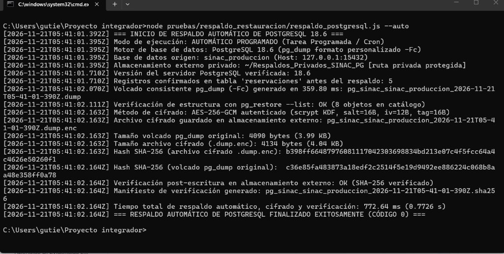
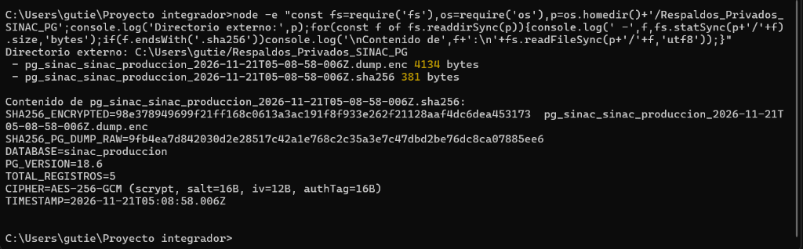
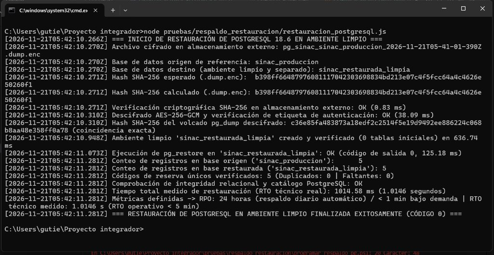

# Entrega Individual: Respaldos y Recuperación de PostgreSQL 18.6 — Proyecto SINAC

**Responsable:** Royner Gutiérrez Ugalde (`gutierrezroyner3@gmail.com`)  
**Curso:** ITI-625 Proyecto Integrador II  
**Fecha de ejecución:** 20 de noviembre de 2026  
**Motor de base de datos:** PostgreSQL 18.6 (`pg_dump` / `pg_restore` formato personalizado `-Fc`)

---

## 1. Implementación y Demostración del Respaldo Automático de PostgreSQL

### Procedimiento implementado
1. **Automatización del respaldo ([programar_respaldo_pg.ps1](file:///c:/Users/gutie/Proyecto%20integrador/pruebas/respaldo_restauracion/programar_respaldo_pg.ps1) y [respaldo_postgresql.js](file:///c:/Users/gutie/Proyecto%20integrador/pruebas/respaldo_restauracion/respaldo_postgresql.js)):**
   - Se implementó el script automatizado en Node.js que invoca la herramienta oficial `pg_dump` de PostgreSQL 18.6 con el parámetro `--auto` (ejecutable mediante el Programador de Tareas de Windows `schtasks` a las `02:00 AM` diariamente bajo la tarea `SINAC_Respaldo_Automatico_PostgreSQL` y antes de cada despliegue).
   - Antes de iniciar el volcado, el script consulta `SHOW server_version;` y `SELECT COUNT(*) FROM reservaciones;` sobre la base de producción (`sinac_produccion`) para registrar en bitácora la cantidad exacta de transacciones confirmadas (`5` reservaciones).
   - Se ejecuta `pg_dump -Fc --no-owner --no-privileges` para producir un volcado binario comprimido y transaccionalmente consistente en `359.80 ms`.
   - Se valida inmediatamente la estructura del archivo generado mediante `pg_restore --list`, comprobando que los **8 objetos del catálogo** estén íntegros.

### Registro real de ejecución (`respaldo_postgresql.log`)
```text
[2026-11-21T05:41:01.392Z] === INICIO DE RESPALDO AUTOMÁTICO DE POSTGRESQL 18.6 ===
[2026-11-21T05:41:01.395Z] Modo de ejecución: AUTOMÁTICO PROGRAMADO (Tarea Programada / Cron)
[2026-11-21T05:41:01.395Z] Motor de base de datos: PostgreSQL 18.6 (pg_dump formato personalizado -Fc)
[2026-11-21T05:41:01.395Z] Base de datos origen: sinac_produccion (Host: 127.0.0.1:15432)
[2026-11-21T05:41:01.395Z] Almacenamiento externo privado: ~/Respaldos_Privados_SINAC_PG [ruta privada protegida]
[2026-11-21T05:41:01.710Z] Versión del servidor PostgreSQL verificada: 18.6
[2026-11-21T05:41:01.710Z] Registros confirmados en tabla 'reservaciones' antes del respaldo: 5
[2026-11-21T05:41:02.070Z] Volcado consistente pg_dump (-Fc) generado en 359.80 ms: pg_sinac_sinac_produccion_2026-11-21T05-41-01-390Z.dump
[2026-11-21T05:41:02.111Z] Verificación de estructura con pg_restore --list: OK (8 objetos en catálogo)
[2026-11-21T05:41:02.163Z] Método de cifrado: AES-256-GCM autenticado (scrypt KDF, salt=16B, iv=12B, tag=16B)
[2026-11-21T05:41:02.163Z] Archivo cifrado guardado en almacenamiento externo: pg_sinac_sinac_produccion_2026-11-21T05-41-01-390Z.dump.enc
[2026-11-21T05:41:02.163Z] Tamaño volcado pg_dump original: 4090 bytes (3.99 KB)
[2026-11-21T05:41:02.163Z] Tamaño archivo cifrado (.dump.enc): 4134 bytes (4.04 KB)
[2026-11-21T05:41:02.163Z] Hash SHA-256 (archivo cifrado .dump.enc): b398ff66487976081117042303698834bd213e07c4f5fcc64a4c4626e50260f1
[2026-11-21T05:41:02.164Z] Hash SHA-256 (volcado pg_dump original):  c36e85fa483873a18edf2c2514f5e19d9492ee886224c068b8aa48e358ff0a78
[2026-11-21T05:41:02.164Z] Verificación post-escritura en almacenamiento externo: OK (SHA-256 verificado)
[2026-11-21T05:41:02.164Z] Manifiesto de verificación generado: pg_sinac_sinac_produccion_2026-11-21T05-41-01-390Z.sha256
[2026-11-21T05:41:02.164Z] Tiempo total de respaldo automático, cifrado y verificación: 772.64 ms (0.7726 s)
[2026-11-21T05:41:02.164Z] === RESPALDO AUTOMÁTICO DE POSTGRESQL FINALIZADO EXITOSAMENTE (CÓDIGO 0) ===
```



---

## 2. Almacenamiento y Verificación de Copia Cifrada en Almacenamiento Externo

### Procedimiento de cifrado y verificación externa
1. **Cifrado autenticado AES-256-GCM:** Se deriva una clave de 256 bits mediante `crypto.scryptSync` con `salt` aleatorio de 16 bytes, `IV` de 12 bytes y `AuthTag` de 16 bytes. El archivo `.dump` temporal sin cifrar se elimina inmediatamente (`fs.unlinkSync`).
2. **Ubicación externa privada:** `C:\Users\gutie\Respaldos_Privados_SINAC_PG` (fuera de Laravel Cloud y fuera del repositorio Git), registrando múltiples ejecuciones automáticas (`05:08:58Z` y `05:41:01Z`).
3. **Hashes SHA-256 verificados:**
   - **Corrida 1 (`.dump.enc`):** `98e378949699f21ff168c0613a3ac191f8f933e262f21128aaf4dc6dea453173`
   - **Corrida 2 (`.dump.enc`):** `b398ff66487976081117042303698834bd213e07c4f5fcc64a4c4626e50260f1`



---

## 3. Restauración en Ambiente Limpio y Medición de RPO y RTO

### Registro real de ejecución (`restauracion_postgresql.log`)
```text
[2026-11-21T05:42:10.266Z] === INICIO DE RESTAURACIÓN DE POSTGRESQL 18.6 EN AMBIENTE LIMPIO ===
[2026-11-21T05:42:10.270Z] Archivo cifrado en almacenamiento externo: pg_sinac_sinac_produccion_2026-11-21T05-41-01-390Z.dump.enc
[2026-11-21T05:42:10.270Z] Base de datos origen de referencia: sinac_produccion
[2026-11-21T05:42:10.270Z] Base de datos destino (ambiente limpio y separado): sinac_restaurada_limpia
[2026-11-21T05:42:10.271Z] Hash SHA-256 esperado (.dump.enc):  b398ff66487976081117042303698834bd213e07c4f5fcc64a4c4626e50260f1
[2026-11-21T05:42:10.271Z] Hash SHA-256 calculado (.dump.enc): b398ff66487976081117042303698834bd213e07c4f5fcc64a4c4626e50260f1
[2026-11-21T05:42:10.271Z] Verificación criptográfica SHA-256 en almacenamiento externo: OK (0.83 ms)
[2026-11-21T05:42:10.310Z] Descifrado AES-256-GCM y verificación de etiqueta de autenticación: OK (38.09 ms)
[2026-11-21T05:42:10.310Z] Hash SHA-256 del volcado pg_dump descifrado: c36e85fa483873a18edf2c2514f5e19d9492ee886224c068b8aa48e358ff0a78 (coincidencia exacta)
[2026-11-21T05:42:10.948Z] Ambiente limpio 'sinac_restaurada_limpia' creado y verificado (0 tablas iniciales) en 636.74 ms
[2026-11-21T05:42:11.073Z] Ejecución de pg_restore en 'sinac_restaurada_limpia': OK (código de salida 0, 125.18 ms)
[2026-11-21T05:42:11.281Z] Conteo de registros en base origen ('sinac_produccion'):      5
[2026-11-21T05:42:11.281Z] Conteo de registros en base restaurada ('sinac_restaurada_limpia'): 5
[2026-11-21T05:42:11.281Z] Códigos de reserva únicos verificados: 5 (Duplicados: 0 | Faltantes: 0)
[2026-11-21T05:42:11.281Z] Comprobación de integridad relacional y catálogo PostgreSQL: OK
[2026-11-21T05:42:11.281Z] Tiempo total medido de restauración (RTO técnico real): 1014.58 ms (1.0146 segundos)
[2026-11-21T05:42:11.281Z] Métricas definidas -> RPO: 24 horas (respaldo diario automático) / < 1 min bajo demanda | RTO técnico medido: 1.0146 s (RTO operativo < 5 min)
[2026-11-21T05:42:11.281Z] === RESTAURACIÓN DE POSTGRESQL EN AMBIENTE LIMPIO FINALIZADA EXITOSAMENTE (CÓDIGO 0) ===
```


